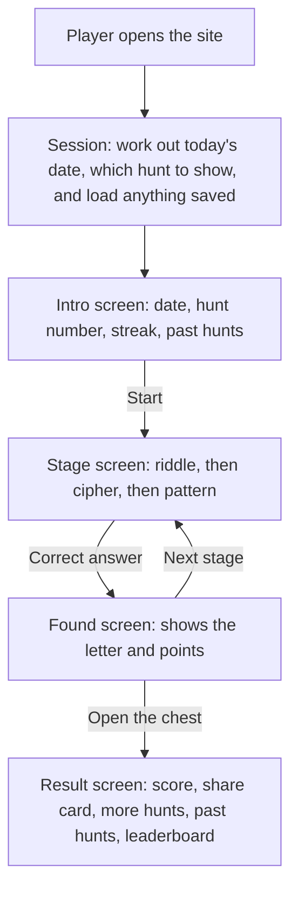
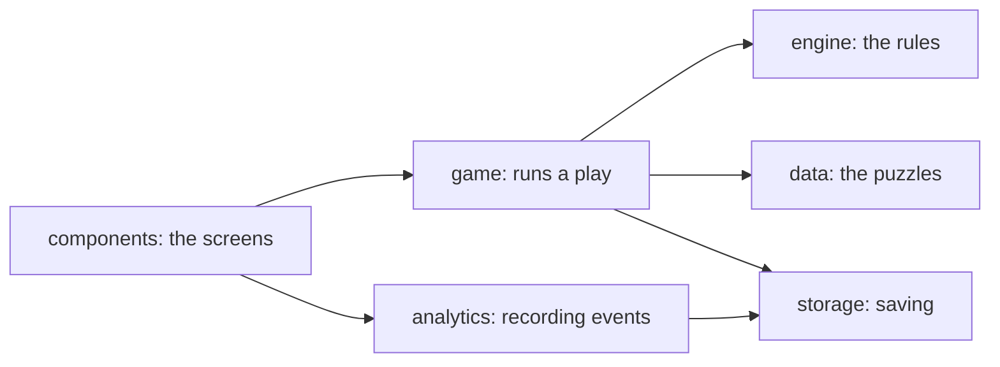

# Daily Trail: a guide to how it works

This guide explains how the game works and what each part of the code does, in plain terms. You do not need to read the code first.

## In one paragraph

Daily Trail is a website. Each day it shows everyone the same treasure hunt: a riddle, a cipher and a pattern. Each answer gives one letter, and the three letters spell a treasure word. There is no server and no login. Everything the game remembers, such as today's progress, your streak and your past hunts, is saved in your own browser. The site is built with React (a library for building screens) and TypeScript (JavaScript with type checks), and Vercel hosts it.

## What happens when someone plays

Step by step:

1. **Opening the site.** The code works out today's date and turns it into a day number, so Nov 6, 2026 is Day 1. It picks one of the seven daily hunts for that day, and loads anything saved in the browser: today's progress, the streak and past hunts.
2. **The streak is checked.** If you missed days since your last visit, the game uses your weekly freeze or resets the streak now, as the site opens.
3. **Playing.** Each tap, such as Start, Submit or Take hint, becomes an action. One function, the reducer, takes the current game state and the action and returns the new state. The screen then redraws from the new state.
4. **Saving.** After every change, the game state is saved to the browser, so a reload carries on where you left off.
5. **Recording.** Each action also records an event, such as `hint_used`, in the browser. These events are what the metrics plan is built on.
6. **Finishing.** The streak goes up by one, the hunt is added to your past hunts, and the result screen appears. If you open the site again today, you go straight back to the result.

## Where things are saved

Everything is saved in the browser's local storage, which is a small store of text that each website keeps on your device. Keys look like `daily-trail:live:streak`.

| Saved item | What it holds |
|---|---|
| `game` | Today's hunt in progress: stage, hints, wrong answers, start time |
| `streak` | Streak count, last day played, and whether the weekly freeze is available |
| `trail` | The daily hunts you have finished, for the past hunts list |
| `events` | Every recorded action, up to the newest 5,000 |
| `player_id` | A random ID for this browser |
| `last_visit` | The last date the game was opened |

Real plays are saved under `live`. Test dates (`?date=`) are saved under `test`, so they never mix with real progress. Practice hunts, replays and `?day=` tests are kept in memory only and are forgotten when you leave the page.

Because nothing goes to a server, a different browser or a private window starts fresh.

## A tour of the code

All the code is in `src/`. Each folder has one job, and the folders depend on each other in one direction only: the screens use the game logic, and the game logic uses the rules and the data. Never the other way round.

### `src/data`: the puzzle book

| File | What it does |
|---|---|
| `hunts.ts` | All puzzle content: the seven daily hunts, the three practice hunts, every hint, and the "How this works" text for each cipher. To change a puzzle, change it here and nowhere else. |
| `hunts.test.ts` | Checks every puzzle: the cipher text decodes to the answer, the first letters spell the treasure word, the last hint shows the answer, and the first two hints never give it away. |

The file `reference/hunts.json` holds the same puzzles without hints. It is the original source, and a test makes sure the two stay in sync.

### `src/engine`: the rule book

These files hold the rules. They are pure functions: put the same thing in and you always get the same thing out. They never draw anything on screen or save anything, which makes them easy to test.

| File | What it does |
|---|---|
| `answers.ts` | Checks an answer. It ignores capitals, punctuation, extra spaces and a leading "a", "an" or "the", so "The Moon!" counts for MOON. It also accepts listed alternatives, so "Aug" counts for AUGUST. |
| `scoring.ts` | Points for a stage: 100 with no hints, then 85, 60 and 20 after each hint. |
| `ciphers.ts` | The three codes: the shift code (Caesar), the mirror code (Atbash) and the swap code (pairs of letters swapped). |
| `dates.ts` | Turns a date into a day number and picks the puzzle for that day. It compares calendar dates, not hours, so a clock change cannot shift the day. |
| `streak.ts` | The streak rules: what happens when you open the game after missing days, and what happens when you finish. |
| `share.ts` | Builds the share text: the hunt number, one square per stage, the time and the streak. |
| `leaderboard.ts` | Makes up the 12 sample players for each day. They are generated from the day number, so they stay the same on reload. |
| `index.ts` | Gathers the files above so other code can import them from one place. |

### `src/game`: the referee

This folder runs a single play: it knows which hunt is on, what stage you are on, and what each action changes.

| File | What it does |
|---|---|
| `session.ts` | Runs once when the site opens. It reads the URL for test options, picks the hunt and mode, opens the right storage, applies the streak check, and loads saved progress and past hunts. |
| `reducer.ts` | The heart of the game. It takes the current state and an action (start, submit, hint, next stage) and returns the new state. It is the only place the game state changes. |
| `selectors.ts` | Small helpers that read from the state: total score, total hints, time taken, and formatted dates and times. |
| `events.ts` | Decides which events to record for each action, such as `answer_wrong` or `stage_completed`. |
| `trail.ts` | Past hunts: makes a record of a finished hunt, adds it to the list, and hides the answers of a past hunt that is today's puzzle again until today is finished. |

### `src/storage`: the drawer

| File | What it does |
|---|---|
| `index.ts` | The only code that touches the browser's local storage. It also provides an in-memory version, used for practice plays, replays and tests, which is thrown away when the page closes. |

### `src/analytics`: the notebook

| File | What it does |
|---|---|
| `track.ts` | `track()` records one event with the player ID, session ID, hunt, puzzle and time. Every user action goes through it. It also defines the list of allowed events and their details. |
| `index.ts` | Sets up the tracker once and shares it with the rest of the app. |

### `src/components`: the screens

Components are the pieces of the screen. They show things and pass taps on to the game, but they contain no puzzle rules.

| File | What it shows |
|---|---|
| `Intro.tsx` | The start screen: date, hunt number, streak, rules, the Start button and past hunts. |
| `GameHeader.tsx` | The bar at the top during play, with the timer and the three letter slots. |
| `LetterSlots.tsx` | The three squares that fill with letters as you solve stages. |
| `Timer.tsx` | The running clock. |
| `Stage.tsx` | One puzzle stage: the question, the cipher tiles and "How this works" panel, the answer box, and the hints. |
| `StageFound.tsx` | The screen after a correct answer, showing the letter you found and your points. |
| `Chest.tsx` | The treasure chest drawing on the result screen. |
| `Result.tsx` | The result screen, which brings together the pieces below. |
| `ShareCard.tsx` | The share text with the Share and Copy buttons. If copying is blocked, it shows the text selected so you can copy it by hand. |
| `MoreHunts.tsx` | Links to the three practice hunts, and "Back to today's hunt" during practice. |
| `Trail.tsx` | Your past hunts, with "View answers" and "Play again". |
| `Leaderboard.tsx` | Today's leaderboard, labelled as sample data. |
| `EventLog.tsx` | The "Event log" panel at the bottom, which lists recorded events and exports them as a JSON file. |

### The files that tie it together

| File | What it does |
|---|---|
| `src/main.tsx` | The starting point. It creates the session, sets up analytics, records the opening events, and puts the app on the page. |
| `src/App.tsx` | The conductor. It holds the game state, sends each action through the reducer, updates the streak and past hunts on finish, records events, and decides which screen to show. |
| `src/styles/tokens.css` | The design settings: colours for light and dark mode, fonts and spacing. Change a colour here and it changes everywhere. |
| `src/styles/app.css` | The styles for every screen, built from those settings. |

## Following one tap through the code

Here is what happens when a player types an answer and presses Submit:

1. `Stage.tsx` passes the typed text to `App.tsx`.
2. `App.tsx` sends a `submit` action to the reducer in `reducer.ts`.
3. The reducer uses `checkAnswer` in `engine/answers.ts`. If the answer is wrong, it adds one to the wrong count. If it is right, it marks the stage solved and works out the points with `engine/scoring.ts`.
4. If it was the last stage, `App.tsx` adds a day to the streak with `engine/streak.ts`, and adds the hunt to past hunts with `game/trail.ts`.
5. `game/events.ts` records `answer_wrong`, or `stage_completed` and possibly `hunt_completed`, through `track()`.
6. The new state is saved to the browser through `storage`.
7. React redraws the screen: the answer box shakes for a wrong answer, or the found screen appears.

## The rules, in plain terms

- **Day number and puzzle number:** the day number counts up forever from Nov 6, 2026 (Day 1). It is the "Hunt #" players see. The puzzle number cycles through the seven daily hunts, so Day 8 shows puzzle 1 again.
- **Points:** each stage is worth 100. Hint 1 costs 15, hint 2 costs 25 more, and hint 3 costs 40 more and shows the answer. Wrong answers cost nothing.
- **Streak:** finishing a hunt adds one. You get one freeze a week (weeks start on Monday). It covers one missed day automatically. Two missed days in a row reset the streak to 0.
- **Share squares:** green for a stage solved with no hint, yellow for one or two hints, black when the answer was shown.
- **Leaderboard:** only your row is real. The other 12 players are made up, and the screen says so.
- **Practice and past hunts:** practice hunts are separate puzzles, so they never spoil a future day. Past hunts can be viewed or played again. Neither changes your streak, score or today's result.

## Ways to open the game

Adding these to the end of the address changes how the game runs. They work on the live site.

| Address ending | What happens | Saved? |
|---|---|---|
| none | Today's real hunt | Yes, under `live` |
| `?date=2026-11-20` | Plays as if it were that date, to test streaks | Yes, under `test`, apart from real progress |
| `?day=3` | Shows daily puzzle 3 | No, memory only |
| `?practice=2` | Practice hunt 2 | No, memory only |
| `?replay=1` | Plays the daily hunt from Day 1 again | No, memory only |
| `?reset=1` | Clears everything saved, then removes itself from the address | Clears saved data |

Events from every mode except the real one are marked as test data and left out of metrics.

## Tests

Each logic file has a matching `.test.ts` file. Run them all with `npm test`. There are 209 tests, covering:

- every puzzle decodes and spells its word, and no early hint gives away the answer
- scoring, answer checking and the three ciphers
- dates, including the day number and the switch to the next week
- streak rules: freezes, resets and the weekly refill
- the reducer: every action in every stage of a play
- saved progress, the test modes, and that practice and replays never write real data
- share text has no spoilers, and the leaderboard ranks correctly
- every event has the right details

The screens were also checked in a real browser during development, at phone sizes, in light and dark mode, and with the keyboard only. Those browser scripts are not part of the repository.

## Common changes

| To do this | Change this |
|---|---|
| Edit a puzzle or hint | `src/data/hunts.ts`, and the same puzzle in `reference/hunts.json`. Then run `npm test`. |
| Add an eighth daily hunt | Add it to `hunts.ts` and `reference/hunts.json`, set `HUNT_COUNT` in `src/engine/dates.ts` to 8, and update the test that expects seven hunts. |
| Change hint costs | `HINT_COST` in `src/engine/scoring.ts`, then update its tests. |
| Change colours or fonts | `src/styles/tokens.css`. |
| Record a new kind of event | Add it to `EventProps` in `src/analytics/track.ts`, call `track()` where it happens, add it to `reference/events.md`, and add an example to `track.test.ts`. |
| Put a change live | Run `npm run build` and `npm test`, then push to `main`. Vercel builds and deploys it automatically. |

## Words used in this guide

| Word | Meaning |
|---|---|
| Component | A piece of the screen, such as a button group or a whole screen, written as a function that returns what to show. |
| State | Everything the game needs to know right now: the stage, the hints used, the start time and so on. |
| Action | Something the player did, such as pressing Submit, described as a small object the reducer can read. |
| Reducer | The function that takes the state and an action and returns the new state. |
| Pure function | A function that only calculates. It gives the same output for the same input, and never saves or draws anything. |
| Local storage | A small amount of text a website can keep in your browser. It stays after you close the tab. |
| Event | A record of one action, with a name, a time and some details, used for metrics. |
| Namespace | The prefix that keeps different sets of saved data apart, such as `live` and `test`. |
